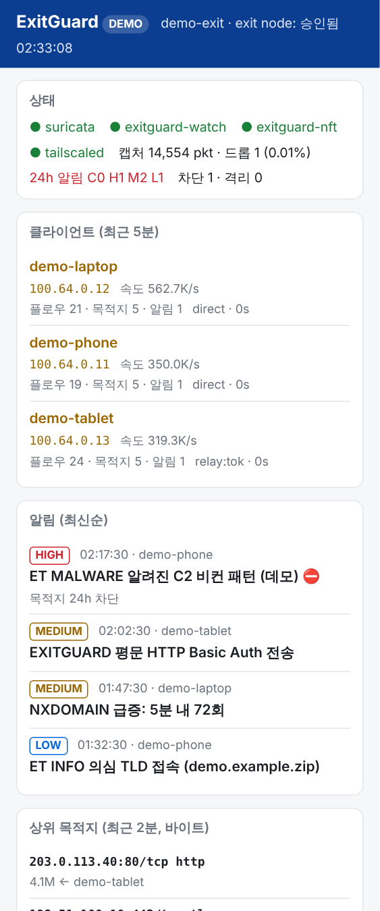

# ExitGuard — Tailscale exit node 트래픽 감시/보고/차단

이 머신을 다른 기기들의 Tailscale exit node 로 쓰면서, 통과하는 모든 트래픽을
감시해 의심 정황을 보고하고 자동으로 차단/격리한다.

## 구성

```
 tailnet 기기들 ──(WireGuard)──▶ tailscale0 ──▶ NAT ──▶ <uplink> ──▶ 인터넷
                                   │
                        Suricata IDS (af-packet, ET Open + local.rules)
                                   │  eve.json
                        exitguard-watch (python)  ──▶ 보고: alerts.log / journald / 데스크톱 / webhook / Telegram
                                   │
                        nftables `inet exitguard` ──▶ 목적지 차단 / 클라이언트 격리 (forward 훅)
```

| 컴포넌트 | 역할 |
|---|---|
| Suricata 8 | `tailscale0` 의 모든 패킷 검사. HOME_NET = tailnet(100.64/10). ET Open 룰 + `local.rules` |
| `exitguard-watch` | eve.json 실시간 분석: IDS 알림, 포트스캔/호스트스윕, DNS DGA·터널링·블랙리스트, 대역폭, 의심 포트 |
| nftables | `blocked4/6`(목적지 차단, 자동 만료), `quarantine4/6`(클라이언트 전체 차단), `clients4`(클라이언트별 카운터) |
| `exitguard-report.timer` | 매일 09:00 리포트(`/var/log/exitguard/reports/`) + 알림 채널 전송 |
| `exitguard-rules.timer` | 매일 04:30 룰 갱신 후 무중단 리로드 |
| `exitguardctl` | 상태/알림/수동 차단/격리/pcap 캡처 CLI |
| `exitguard-top` | curses 대시보드. 원격 SSH 에서 한 화면으로 상태 파악, root 면 즉시 조치. `--web` 은 읽기 전용 브라우저 대시보드 |

## 설치

```bash
cd ~/exitnode-guard
sudo ./install.sh
```
그 다음 Tailscale 관리 콘솔(Machines → <이 머신> → Edit route settings)에서 **Use as exit node** 를 승인한다.
각 기기에서 exit node 를 이 머신으로 선택하면 트래픽이 이 머신을 경유한다.

## 탐지 → 조치 정책 (`/etc/exitguard/config.json`)

| 탐지 | 등급 | 기본 조치 |
|---|---|---|
| Suricata severity 1 (멀웨어/C2/익스플로잇/채굴 등 `block_categories`) | HIGH | **외부 목적지 IP 24h 차단** |
| Suricata severity 2 (정책 위반, 의심 포트 등) | MEDIUM | 보고 |
| 한 클라이언트가 10분 내 HIGH 5회 | CRITICAL | **클라이언트 1h 격리**(전체 포워딩 차단) |
| 60초 내 한 호스트에 25개 이상 포트 / 한 포트로 100개 이상 호스트 | MEDIUM | 보고 (`block_scanned_dest` 로 차단 가능) |
| NXDOMAIN 60회/5분 (DGA) | MEDIUM | 보고 |
| 긴 고엔트로피 서브도메인 30회/5분 (DNS 터널링) | MEDIUM | 보고 |
| `blocklist_domains` 질의 | HIGH | 보고 + 격리 카운트 |
| 시간당 5GB 초과 | LOW | 보고 |
| 의심 TLD / 의심 포트 접속 | LOW | 보고 |

- `never_block`: 사설망·tailnet·주요 DNS 는 절대 차단하지 않음.
- `notify.min_level`: 이 등급 이상만 데스크톱/webhook/Telegram 으로 발송(기본 MEDIUM). 모든 등급은 `alerts.log` 에 기록.
- 외부 알림: `notify.webhook_url`(Discord/Slack 호환 JSON) 또는 `notify.telegram.{bot_token,chat_id}` 입력 후 `sudo systemctl restart exitguard-watch`.

## 데모 모드 (설치 없이 화면만 보기)

Suricata·nftables·Tailscale 없이 가짜 데이터로 대시보드를 띄운다. Python 3 표준 라이브러리만 쓰므로
macOS·Replit 등 어디서나 바로 실행된다. 아무것도 차단하지 않으며, root 로 실행해도 조치 키는 꺼진다.

```bash
python3 exitguard/dash.py --demo          # curses 대시보드 (q 종료)
python3 exitguard/dash.py --demo --text   # 스냅샷 한 번 출력
python3 exitguard/dash.py --demo --web    # 브라우저 대시보드 → http://127.0.0.1:8080/
```

데모 데이터는 임의의 CGNAT 주소, 문서용 IP 대역(RFC 5737), 예시 도메인(RFC 2606)만 사용한다.

## 대시보드 (원격 터미널)

```bash
exitguard-top            # 조회 전용 (일반 사용자)
sudo exitguard-top       # 차단/격리/pcap 조치 가능 + nft 실시간 속도 표시
exitguard-top --text     # 한 번 출력(스크립트/좁은 터미널용)
```

- 상단: 서비스 상태(●/✖), 캡처 패킷/드롭률, 24h 알림 수(C/H/M/L), 차단/격리 수.
- 클라이언트 패널: 기기명, IP, 속도(root) 또는 5분 전송량, 플로우/목적지 수, 알림 수, 링크(direct/relay), 마지막 활동. 격리된 기기는 ⛔ 빨간색.
- 알림 패널: 최신순, 등급별 색(빨강 HIGH/CRITICAL, 노랑 MEDIUM, 청록 LOW). 자동 조치된 건은 ⛔.
- 실시간 접속지: TLS/QUIC SNI, DNS 질의, HTTP 호스트를 기기별로 흘려 보여줌.
- 상위 목적지(폭 130 이상일 때): 최근 2분 바이트 기준.
- 키: `q` 종료, `+`/`-` 갱신 주기, root 일 때 `b` 차단 / `u` 해제 / `Q` 격리 / `R` 격리 해제 / `c` pcap 캡처.

## 웹 대시보드 (읽기 전용, 브라우저·폰)

같은 데이터를 브라우저에서 본다. 표준 라이브러리(`http.server`)만 쓰고, 페이지는 인라인 CSS/JS 한 장이며 2초마다 갱신된다.
폰 폭(375px)에서는 세로 한 줄로, 넓은 화면에서는 2열로 보인다.

```bash
exitguard-top --web                          # http://127.0.0.1:8080/
exitguard-top --web --host 127.0.0.1 --port 9000
python3 exitguard/dash.py --demo --web       # 설치 없이 데모 데이터로
```

| 경로 | 내용 |
|---|---|
| `GET /` | 대시보드 HTML |
| `GET /api/snapshot` | 상태·클라이언트·상위 목적지·알림·실시간 접속지 JSON |

- **읽기 전용**: 차단·격리·pcap 같은 조치는 웹에 없다. GET 외 메서드는 405. 조치는 터미널(`sudo exitguard-top`, `exitguardctl`)에서만.
- 기본 바인딩은 `127.0.0.1:8080`. Replit 미리보기처럼 외부 포트 포워딩이 필요한 환경에서는 `--host 0.0.0.0` 을 쓴다.

> ⚠️ **인증이 없다.** 접속 기기·목적지·알림이 그대로 보이므로 `--host 0.0.0.0` 으로 인터넷에 직접 열지 말 것.
> 외부(폰 등)에서 보려면 루프백에 둔 채 **Tailscale serve** 같은 인증된 경로로 노출한다:
> `sudo tailscale serve --bg 8080` → tailnet 안의 기기에서만 `https://<이 머신>.<tailnet>.ts.net/` 로 접속.
> `tailscale funnel` 은 공개 인터넷 노출이므로 쓰지 않는다.



## 운용

```bash
exitguardctl status            # 서비스/exit node/차단 현황
exitguardctl watch             # 알림 실시간
exitguardctl clients           # 클라이언트별 패킷/바이트 (실시간 nft 카운터)
exitguardctl top 120           # 최근 120초 목적지 TOP
exitguardctl report 7          # 최근 7일 리포트
exitguardctl list              # 차단/격리 목록
exitguardctl block 1.2.3.4 48  # 수동 차단 48h
exitguardctl unblock 1.2.3.4
exitguardctl quarantine 100.x.y.z 2
exitguardctl release 100.x.y.z
exitguardctl capture 100.x.y.z 120   # 의심 기기 pcap 캡처 → /var/log/exitguard/pcap/
exitguardctl logs              # watcher 서비스 로그
```

로그 위치: `/var/log/exitguard/alerts.log`(사람용), `alerts.jsonl`(기계용), `/var/log/suricata/{eve.json,fast.log}`.

## 주의

- 차단은 **포워딩 트래픽(forward 훅)** 에만 적용되므로 이 머신 자체의 통신엔 영향 없음.
- 격리는 자기 기기를 끊는 것이므로 오탐 시 `exitguardctl release` 로 즉시 해제. 공격적이면 `quarantine.enabled=false`.
- ET Open 룰은 오탐이 있을 수 있음. 특정 sid 를 무시하려면 `/etc/suricata/disable.conf` 에 sid 추가 후 `exitguardctl rules-update`.
- Suricata 가 TLS 내부는 볼 수 없음(SNI/JA3/인증서까지만). 그래서 DNS·목적지·행위 기반 탐지를 함께 사용.
- 제거: `sudo ./uninstall.sh`

## 라이선스

MIT — [LICENSE](LICENSE)
