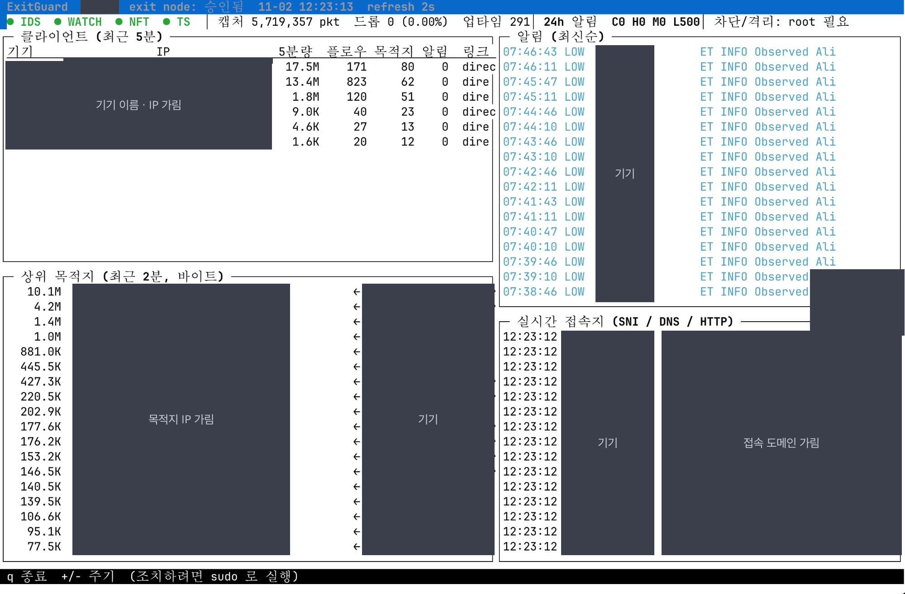
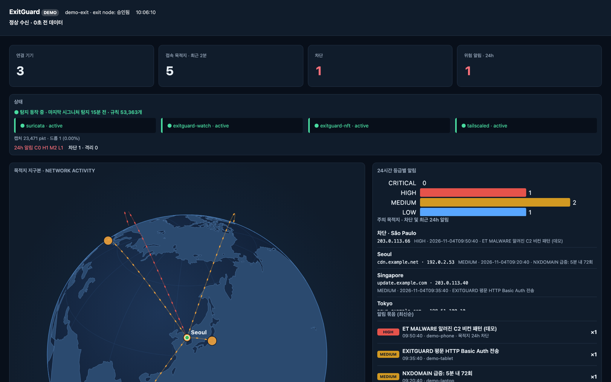
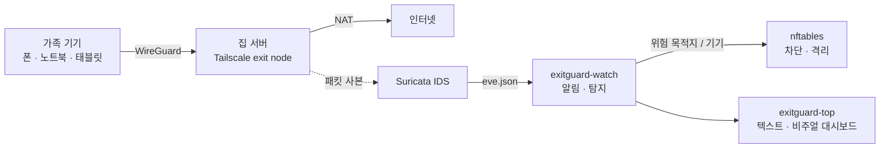

# ExitGuard — 우리 집 인터넷 관제탑

[](https://exitguard.replit.app)
[](https://github.com/misolove/exitguard/actions/workflows/test.yml)


**집 서버 한 대를 가족 기기들의 인터넷 출구(Tailscale exit node)로 쓰면서, 그 출구를 지나는 모든 트래픽을
감시하고, 의심 정황을 알리고, 필요하면 자동으로 차단·격리한다.** 터미널로도, 지구본 대시보드로도 본다.

*A home-lab IDS for your Tailscale exit node — watch, alert and block every device's traffic, in your terminal or on a live globe.*

### ▶ 설치 없이 바로 보기: **[exitguard.replit.app](https://exitguard.replit.app)**
<sub>가짜 데이터로 도는 공개 데모. 실제 트래픽은 없고 아무것도 차단하지 않는다.</sub>

## 화면 두 개, 엔진 하나

| 🖥️ 텍스트 모드 — `exitguard-top` | 🌏 비주얼 모드 — `exitguard-top --web` |
|---|---|
| SSH 한 줄이면 어디서든. root 면 그 자리에서 **차단·격리** | 폰·노트북 브라우저로. **목적지 지구본**, 알림 묶음, 기기별 그래프 (읽기 전용) |
|  |  |
| <sub>실제 집 서버 화면 (기기 이름·IP·도메인은 가림)</sub> | <sub>데모 데이터 ([라이브 데모](https://exitguard.replit.app))</sub> |

두 화면은 같은 데이터 엔진(`core.py`)을 쓴다. 탐지를 고치면 두 화면에 함께 반영된다.

## 왜 믿을 만한가

- **의존성 0**: Python 표준 라이브러리만. `pip install` 도, 외부 CDN·지도 타일·폰트도 없다. 내 접속 기록이 대시보드를 통해 밖으로 새지 않는다
- **"알림 0건" 을 그대로 믿지 않는다**: 화면이 *마지막 시그니처 탐지 시각·적재된 규칙 수·HOME_NET 설정* 을 함께 보여준다. 조용한 것인지 탐지가 멈춘 것인지 구분된다
- **모르면 모른다고 표시**: 권한이 없어 못 읽은 값은 0 이 아니라 "확인 불가"
- **웹은 읽기 전용**: GET 만, 엄격한 CSP, exit node 에서는 tailnet 주소에만 연다. 조치는 터미널에서만
- **오프라인 지도**: 목적지 위치는 내려받아 둔 GeoIP(나라 단위)로만 계산. 실행 중 외부 조회 없음

## 실제 운영에서 잡아낸 것들

이 레포는 2026-10 부터 실제 집에서 돌고 있는 시스템의 공개본이다. 운영하면서 고친 것들이 그대로 들어 있다.

- **IDS 가 이틀 동안 조용히 꺼져 있었다.** 매일 규칙을 재적재하면 Suricata 의 `HOME_NET` 이 기본값으로 돌아가 거의 모든 규칙이 빗나갔다. 화면은 "위험 알림 0" 이라 아무도 몰랐다 → 설정 고정, 재적재 후 자동 점검·HIGH 알림, 화면에 *탐지 건강* 표시 ([#17](https://github.com/misolove/exitguard/pull/17), [#18](https://github.com/misolove/exitguard/pull/18))
- **네트워크에서 온 NUL 문자 하나에 대시보드가 죽었다.** QUIC SNI 끝에 붙은 `\x00` → 화면에 찍기 전 제어문자·방향 조작 문자 정화 (터미널 이스케이프 주입도 함께 차단) ([#10](https://github.com/misolove/exitguard/pull/10))
- **트랙패드 핀치가 Safari 에서만 안 됐다.** 매 프레임 다시 그리는 SVG 요소가 제스처를 끊었다 ([#16](https://github.com/misolove/exitguard/pull/16))

## 한눈에

| | |
|---|---|
| **무엇을** | 가족 기기(폰·노트북·태블릿)가 어디와 통신하는지 한 곳에서 본다 |
| **어떻게** | 트래픽을 Tailscale로 집 서버에 모으고 → Suricata IDS로 검사 → 위험하면 nftables로 차단 |
| **보는 법** | SSH 터미널 대시보드 `exitguard-top`, 또는 브라우저용 읽기 전용 웹 대시보드 `--web` |
| **상태** | 2026-10 부터 실제 운영 중. 이 레포는 민감정보를 뺀 공개본 |



## 30초 체험 (설치 없이)

브라우저만 있으면: **[exitguard.replit.app](https://exitguard.replit.app)**. 내 컴퓨터에서 돌려 보려면 Python 3 만 있으면 된다. 가짜 트래픽으로 돌아가며 아무것도 차단하지 않는다.

```bash
git clone https://github.com/misolove/exitguard && cd exitguard
python3 exitguard/dash.py --demo          # 텍스트 모드 (q 종료)
python3 exitguard/dash.py --demo --web    # 비주얼 모드 → http://127.0.0.1:8080
```


<sub>비주얼 모드는 [Replit Nexus Build Day Seoul](https://luma.com/7qdoj61s) (2026-11-03) 에서 Replit 으로 만들고, 보안·운영 쪽은 Claude Code 로 다듬었다.</sub>

## 구성

```
 tailnet 기기들 ──(WireGuard)──▶ tailscale0 ──▶ NAT ──▶ <uplink> ──▶ 인터넷
                                   │
                        Suricata IDS (af-packet, ET Open + local.rules)
                                   │  eve.json
                        exitguard-watch (python)  ──▶ 보고: alerts.log / journald / 데스크톱 / webhook / Telegram
                                   │
                        nftables `inet exitguard` ──▶ 목적지 차단 / 클라이언트 격리 (forward 훅)
```

| 컴포넌트 | 역할 |
|---|---|
| Suricata 8 | `tailscale0` 의 모든 패킷 검사. HOME_NET = tailnet(100.64/10). ET Open 룰 + `local.rules` |
| `exitguard-watch` | eve.json 실시간 분석: IDS 알림, 포트스캔/호스트스윕, DNS DGA·터널링·블랙리스트, 대역폭, 의심 포트 |
| nftables | `blocked4/6`(목적지 차단, 자동 만료), `quarantine4/6`(클라이언트 전체 차단), `clients4`(클라이언트별 카운터) |
| `exitguard-report.timer` | 매일 09:00 리포트(`/var/log/exitguard/reports/`) + 알림 채널 전송 |
| `exitguard-rules.timer` | 매일 04:30 룰 갱신 후 무중단 리로드 |
| `exitguardctl` | 상태/알림/수동 차단/격리/pcap 캡처 CLI |
| `exitguard-top` | curses 대시보드. 원격 SSH 에서 한 화면으로 상태 파악, root 면 즉시 조치. `--web` 은 읽기 전용 브라우저 대시보드 |

대시보드 코드는 데이터 엔진 하나에 화면 두 개(텍스트판·웹판)로 나뉜다. 데이터를 고치면 두 화면에 함께 반영된다.

| 파일 | 내용 |
|---|---|
| `exitguard/core.py` | 데이터 엔진: 설정, 수집(`Model`/`DemoModel`), 집계(`snapshot` = `/api/snapshot`) |
| `exitguard/tui.py` | 텍스트판: curses 화면(`exitguard-top`), `--text` |
| `exitguard/web.py` | 웹판 서버: 읽기 전용 GET, CSP, 정해진 정적 파일만 응답 |
| `exitguard/static/` | 웹판 화면: `index.html`, `viz.js`(지구본·차트), 지도 데이터 |
| `exitguard/dash.py` | 진입점(`exitguard-top`). 옵션에 따라 텍스트판/웹판 실행 |

## 설치

```bash
cd ~/exitnode-guard
sudo ./install.sh
```
그 다음 Tailscale 관리 콘솔(Machines → <이 머신> → Edit route settings)에서 **Use as exit node** 를 승인한다.
각 기기에서 exit node 를 이 머신으로 선택하면 트래픽이 이 머신을 경유한다.

## 탐지 → 조치 정책 (`/etc/exitguard/config.json`)

| 탐지 | 등급 | 기본 조치 |
|---|---|---|
| Suricata severity 1 (멀웨어/C2/익스플로잇/채굴 등 `block_categories`) | HIGH | **외부 목적지 IP 24h 차단** |
| Suricata severity 2 (정책 위반, 의심 포트 등) | MEDIUM | 보고 |
| 한 클라이언트가 10분 내 HIGH 5회 | CRITICAL | **클라이언트 1h 격리**(전체 포워딩 차단) |
| 60초 내 한 호스트에 25개 이상 포트 / 한 포트로 100개 이상 호스트 | MEDIUM | 보고 (`block_scanned_dest` 로 차단 가능) |
| NXDOMAIN 60회/5분 (DGA) | MEDIUM | 보고 |
| 긴 고엔트로피 서브도메인 30회/5분 (DNS 터널링) | MEDIUM | 보고 |
| `blocklist_domains` 질의 | HIGH | 보고 + 격리 카운트 |
| 시간당 5GB 초과 | LOW | 보고 |
| 의심 TLD / 의심 포트 접속 | LOW | 보고 |

- `never_block`: 사설망·tailnet·주요 DNS 는 절대 차단하지 않음.
- `notify.min_level`: 이 등급 이상만 데스크톱/webhook/Telegram 으로 발송(기본 MEDIUM). 모든 등급은 `alerts.log` 에 기록.
- 외부 알림: `notify.webhook_url`(Discord/Slack 호환 JSON) 또는 `notify.telegram.{bot_token,chat_id}` 입력 후 `sudo systemctl restart exitguard-watch`.
- **Slack 버튼 연결** ("Add to Slack"): webhook 주소를 손으로 옮기지 않고 Slack 로그인·채널 선택으로 연결한다.
  ```bash
  sudo exitguardctl slack-connect --setup   # 처음 한 번: 출력된 링크로 Slack 앱 생성(설정 채워짐) → Client ID·Secret 입력 (/etc/exitguard/slack-app.json, 0600)
  sudo exitguardctl slack-connect           # 5분 대기: 웹 대시보드의 "Slack에 연결" 버튼 → 로그인·채널 선택 → 터미널에서 확인
  ```
  - 콜백은 `tailscale serve` 로 연 tailnet 전용 HTTPS(`https://<머신>.<tailnet>.ts.net:8443/slack/callback`)로 5분 동안만 받고 닫는다 (funnel 아님). `state` 값이 다르면 거부
  - 저장 전 터미널에서 워크스페이스·채널을 확인하고, 저장 뒤 테스트 메시지 전송·`exitguard-watch` 재시작
  - 상시 웹 대시보드는 그대로 읽기 전용이다. 버튼은 대기 중일 때만 나타나는 slack.com 승인 링크일 뿐이고, 설정은 root 로 도는 일회용 명령만 쓴다

## 데모 모드 (설치 없이 화면만 보기)

Suricata·nftables·Tailscale 없이 가짜 데이터로 대시보드를 띄운다. Python 3 표준 라이브러리만 쓰므로
macOS·Replit 등 어디서나 바로 실행된다. 아무것도 차단하지 않으며, root 로 실행해도 조치 키는 꺼진다.

```bash
python3 exitguard/dash.py --demo          # curses 대시보드 (q 종료)
python3 exitguard/dash.py --demo --text   # 스냅샷 한 번 출력
python3 exitguard/dash.py --demo --web    # 브라우저 대시보드 → http://127.0.0.1:8080/
```

데모 데이터는 임의의 CGNAT 주소, 문서용 IP 대역(RFC 5737), 예시 도메인(RFC 2606)만 사용한다.

## 테스트

데모 모드로 대시보드(curses·`--text`·`--web`)를 검사한다. 표준 라이브러리(`unittest`, `pty`)만 쓰므로 추가 설치가 필요 없고,
Suricata·nftables·Tailscale·root 권한도 필요 없다. pty 를 쓰므로 Linux·macOS 에서 실행한다.
PR 과 main 푸시마다 GitHub Actions(`.github/workflows/test.yml`)가 Ubuntu Python 3.9~3.13, macOS Python 3.13 에서 자동 실행한다.

```bash
python3 -m unittest discover -s tests -v                    # 전체 (약 20~30초)
python3 -m unittest tests.test_dash_layout.TestVirtualScreen -v   # 가상 화면 검사만 (1초 내외)
```

| 테스트 | 확인 내용 |
|---|---|
| `TestNarrowLayout` | pty 로 폭 40/60/80/150 터미널을 만들어 curses 화면이 예외 없이 그려지고 `q` 로 종료되는지 |
| `TestNarrowLayoutRoot` | 같은 확인을 root 모드로. `IS_ROOT` 는 테스트 프로세스 안에서만 켜고 차단/격리 조치는 막는다 |
| `TestVirtualScreen` | 가짜 curses 창에 그려 폭 38~160 전 구간에서 줄이 화면 폭을 넘지 않는지, 폭별 축약 표기(상태줄·하단 안내·클라이언트 열)가 맞는지 |
| `WebDemoTest` (`test_web.py`) | `--demo --web` 서버: 기본 루프백 바인드, JSON 스냅샷, 읽기 전용(GET 외 405), 없는 경로 404 |
| `TextDemoUnchangedTest` (`test_web.py`) | `--demo --text` 출력이 `tests/demo_text.golden` 과 같은지 (시각만 가리고 비교) |

`--text` 출력 형식을 일부러 바꿨다면 기준 파일을 다시 만든다(변경 내용을 diff 로 확인한 뒤 커밋):

```bash
python3 -c "import subprocess,sys; sys.path.insert(0,'tests'); from test_web import mask; \
open('tests/demo_text.golden','w').write(mask(subprocess.run([sys.executable,'exitguard/dash.py','--demo','--text'],capture_output=True,text=True).stdout))"
```

## 대시보드 (원격 터미널)

```bash
exitguard-top            # 조회 전용 (일반 사용자)
sudo exitguard-top       # 차단/격리/pcap 조치 가능 + nft 실시간 속도 표시
exitguard-top --text     # 한 번 출력(스크립트/좁은 터미널용)
```

- 상단: 서비스 상태(●/✖), 캡처 패킷/드롭률, 24h 알림 수(C/H/M/L), 차단/격리 수.
- 클라이언트 패널: 기기명, IP, 속도(root) 또는 5분 전송량, 플로우/목적지 수, 알림 수, 링크(direct/relay), 마지막 활동. 격리된 기기는 ⛔ 빨간색.
- 알림 패널: 최신순, 등급별 색(빨강 HIGH/CRITICAL, 노랑 MEDIUM, 청록 LOW). 자동 조치된 건은 ⛔.
- 실시간 접속지: TLS/QUIC SNI, DNS 질의, HTTP 호스트를 기기별로 흘려 보여줌.
- 상위 목적지(폭 130 이상일 때): 최근 2분 바이트 기준.
- 좁은 터미널: 폭 80 미만이면 IP 열을 숨기고, 60 미만이면 기기명·속도·알림만 보여준다. 상태줄은 한 줄에 안 들어가면 2줄로 나뉜다.
- 키: `q` 종료, `+`/`-` 갱신 주기, root 일 때 `b` 차단 / `u` 해제 / `Q` 격리 / `R` 격리 해제 / `c` pcap 캡처.

## 웹 대시보드 (읽기 전용, 브라우저·폰)

같은 데이터를 브라우저에서 본다. 표준 라이브러리(`http.server`)만 쓰고, 페이지는 인라인 CSS/JS 한 장이며 2초마다 갱신된다.
폰 폭(375px)에서는 세로 한 줄로, 넓은 화면에서는 2열로 보인다.

```bash
exitguard-top --web                          # http://127.0.0.1:8080/
exitguard-top --web --host 127.0.0.1 --port 9000
python3 exitguard/dash.py --demo --web       # 설치 없이 데모 데이터로
```

| 경로 | 내용 |
|---|---|
| `GET /` | 대시보드 HTML |
| `GET /api/snapshot` | 상태·클라이언트·상위 목적지·알림·실시간 접속지 JSON |

- **읽기 전용**: 차단·격리·pcap 같은 조치는 웹에 없다. GET 외 메서드는 405. 조치는 터미널(`sudo exitguard-top`, `exitguardctl`)에서만.
- 기본 바인딩은 `127.0.0.1:8080`. Replit 미리보기처럼 외부 포트 포워딩이 필요한 환경에서는 `--host 0.0.0.0` 을 쓴다.

> ⚠️ **인증이 없다.** 접속 기기·목적지·알림이 그대로 보이므로 `--host 0.0.0.0` 으로 인터넷에 직접 열지 말 것.
> 외부(폰 등)에서 보려면 루프백에 둔 채 **Tailscale serve** 같은 인증된 경로로 노출한다:
> `sudo tailscale serve --bg 8080` → tailnet 안의 기기에서만 `https://<이 머신>.<tailnet>.ts.net/` 로 접속.
> `tailscale funnel` 은 공개 인터넷 노출이므로 쓰지 않는다.

### 지구본에 실제 목적지 표시 (오프라인 GeoIP, 선택)

실제 모드의 지구본은 오프라인 IP→국가 DB 가 있을 때만 그려진다. 실행 중 외부 조회는 하지 않는다.
- 데이터: [DB-IP IP to Country Lite](https://db-ip.com/db/download/ip-to-country-lite) (무료, 매월 갱신, **CC BY 4.0**). 레포에는 넣지 않는다
- 위치는 **나라 단위**(국가 중심 좌표, `exitguard/geoip.py` 의 직접 작성 표)이며 IP 의 실제 위치가 아니다
- 웹 화면 지구본 아래에 출처 "IP Geolocation by DB-IP" 를 표시한다 (라이선스 조건)

```bash
sudo /usr/local/lib/exitguard/geoip-update.sh        # 받기 (검증 후 교체, 이번 달 파일이 없으면 지난달)
sudo systemctl enable --now exitguard-geoip.timer    # 매달 3일 05시 무렵 자동 갱신 (bin/deploy.sh 는 파일이 있으면 자동으로 켬)
# 집(지구본의 출발점) 위치. 비밀값이 아니므로 0644 (웹 서비스가 권한 없이 읽는다). 도시 수준이면 충분
echo '{"home": {"lat": 37.57, "lon": 126.98, "city": "Seoul"}}' | sudo tee /etc/exitguard/geo.json
```

- 설정 파일 `/etc/exitguard/geo.json`: `{"db": "<경로>", "home": {"lat", "lon", "city"}}`. `db` 기본값은 위 경로, `home` 은 기본값 없음 (없으면 지구본을 그리지 않음)
- DB 파일이 바뀌면 1분 안에 다시 읽는다 (재시작 불필요). 메모리는 약 100MB 늘어난다
- 갱신(`exitguard-geoip.service`)은 `/var/lib/exitguard` 에만 쓸 수 있게 제한된다. 다운로드·압축·행 수 검증에 실패하면 기존 파일을 유지한다
- 트래픽 상위 60개 목적지 + 차단 목적지만 점으로 그린다

### 상시 서비스 (`exitguard-web.service`)

exit node 에서 웹 대시보드를 계속 띄워 두려면 `systemd/exitguard-web.service` 를 쓴다 (install.sh 는 켜지 않음, 선택).
- tailnet IPv4(`100.x`) 에만 바인딩한다. 주소를 못 얻으면 실패 후 재시도하며 `0.0.0.0` 으로 열리지 않는다.
- 권한 없는 전용 시스템 사용자 `exitguard-web` 으로 실행한다 (install.sh·deploy.sh 가 만듦). 조회 전용이라 nft 차단 목록은 보이지 않는다 (화면에 "확인 불가").
- tailnet 기기에서 `http://<exit node 이름>:8080/` 로 접속.

개발 PC 에서 코드만 갱신할 때 (텍스트판·웹판·감시 코드, sudo 한 번):

```bash
bin/deploy.sh user@exit-node
```

기존 `/usr/local/lib/exitguard` 를 `/var/backups/exitguard/<시각>/` 에 백업한 뒤 설치하고 웹 서비스를 켠다/재시작한다.
`watch.py`·`common.py` 가 바뀐 경우에만 `exitguard-watch` 도 재시작한다.


## 운용

```bash
exitguardctl status            # 서비스/exit node/차단 현황
exitguardctl watch             # 알림 실시간
exitguardctl clients           # 클라이언트별 패킷/바이트 (실시간 nft 카운터)
exitguardctl top 120           # 최근 120초 목적지 TOP
exitguardctl report 7          # 최근 7일 리포트
exitguardctl list              # 차단/격리 목록
exitguardctl block 1.2.3.4 48  # 수동 차단 48h
exitguardctl unblock 1.2.3.4
exitguardctl quarantine 100.x.y.z 2
exitguardctl release 100.x.y.z
exitguardctl capture 100.x.y.z 120   # 의심 기기 pcap 캡처 → /var/log/exitguard/pcap/
exitguardctl logs              # watcher 서비스 로그
```

로그 위치: `/var/log/exitguard/alerts.log`(사람용), `alerts.jsonl`(기계용), `/var/log/suricata/{eve.json,fast.log}`.

## 주의

- 차단은 **포워딩 트래픽(forward 훅)** 에만 적용되므로 이 머신 자체의 통신엔 영향 없음.
- 격리는 자기 기기를 끊는 것이므로 오탐 시 `exitguardctl release` 로 즉시 해제. 공격적이면 `quarantine.enabled=false`.
- ET Open 룰은 오탐이 있을 수 있음. 특정 sid 를 무시하려면 `/etc/suricata/disable.conf` 에 sid 추가 후 `exitguardctl rules-update`.
- Suricata 가 TLS 내부는 볼 수 없음(SNI/JA3/인증서까지만). 그래서 DNS·목적지·행위 기반 탐지를 함께 사용.
- `HOME_NET`(tailnet 대역)은 `suricata.yaml` 에 직접 기록한다. 시작 옵션 `--set` 만으로는 매일 규칙 재적재 뒤 기본값(사설망)으로 돌아가 대부분의 규칙이 걸리지 않는다. 룰 갱신(`exitguard-rules`)은 재적재 후 규칙 적재를 확인하고, 실패하면 HIGH 알림(`ids-health`)을 보낸다.
- 제거: `sudo ./uninstall.sh`

## 라이선스

MIT — [LICENSE](LICENSE)
